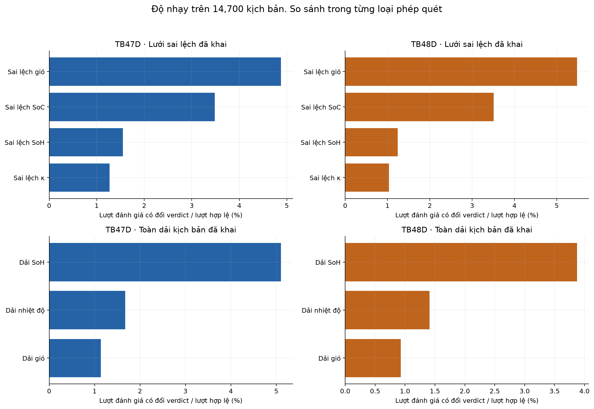
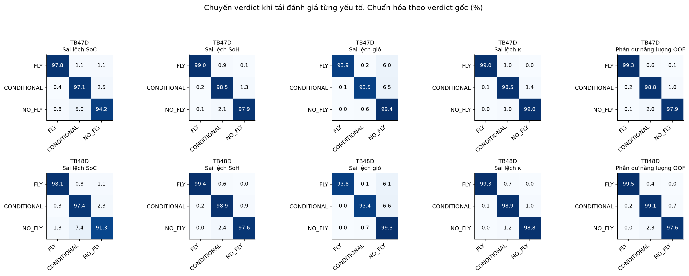
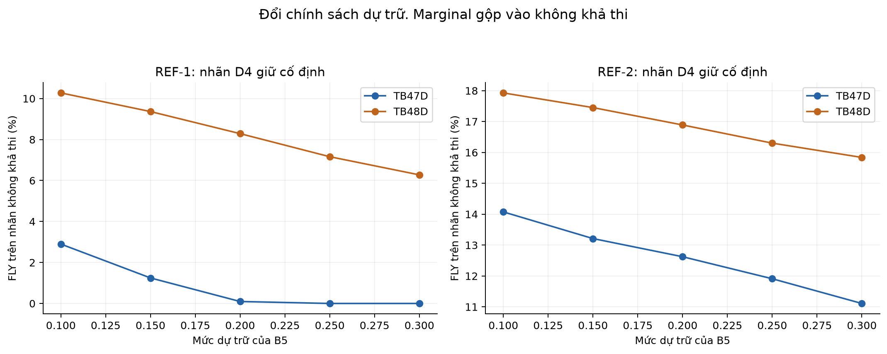

# D5 — Báo cáo tổng hợp độ bền của quyết định trước chuyến bay

> **Bản đọc trên GitHub:** kèm các bảng nhỏ và ba biểu đồ. Kết quả chi tiết nhiều GB, kho snapshot/replay, tài liệu proposal và nhật ký đầy đủ được lưu riêng; không kèm trong Git. Các đường dẫn nguồn trong metadata mô tả lần chạy lịch sử, không phải liên kết tải dữ liệu. Xem [phạm vi bản chia sẻ](README.md). Kiểm chứng lại toàn bộ cần kho hiện vật gốc hoặc chạy thí nghiệm mới.

**Bản tổng hợp ngày 26/10/2026 — phục vụ kiểm tra chéo; chưa nghiệm thu.**

Người thực hiện ghi trong protocol: Duy. Người kiểm tra chéo: Phat. Protocol hiện tại v0.6.1, trạng thái DRAFT, frozen=false, kiểm tra chéo PENDING.

Báo cáo này gom bằng chứng đã lưu của D5 thành một tài liệu. Các mô phỏng, bảng nhạy, catalogue, replay và đối chiếu tham chiếu đều giữ phiên bản/lần chạy gốc. Không chạy thêm Monte Carlo, không huấn luyện mô hình khi tổng hợp.

## 1. Kết quả chính

- Phạm vi chính: 14,700 ID kịch bản tổng hợp, hai giả định pin TB47D/TB48D.
- Monte Carlo: 4,410,000,000 lượt đánh giá mẫu, ba seed, năm cấu hình sai số; 441,000 dòng kết quả.
- Thử từng yếu tố: 7,467,600 điểm; 7,414,866 hợp lệ, 52,734 không hợp lệ.
- Cấu hình sai số chính có 248 ca TB47D và 209 ca TB48D ban đầu FLY nhưng có mẫu thiếu dự trữ; tổng 457 cặp ID–pin.
- Trong 457 ca đó, riêng sai số năng lượng tạo thiếu dự trữ ở 184 ca; riêng SoC ở 31 ca. Có 273 ca không thiếu khi thử riêng từng yếu tố trên lưới chính.
- Danh mục tình huống: 31 ví dụ đại diện cho 11 nhóm; gồm cả cảnh báo và ca bị chặn đúng.
- Lưu và chạy lại: 24/24 bản khớp toàn bộ đầu ra; 41/41 kiểm tra quy trình đạt.
- Tính nhãn tham chiếu lại cho TB48D: 2.099 nhãn REF-1 và 3.188 nhãn REF-2 đổi ở đầu vào gốc.
- Kiểm tra đề xuất: 2,245 ID × hai pin; 244,596 thay đổi áp dụng được; 2,915 đề xuất ứng viên. Không phải mọi đề xuất FLY đều qua cả hai REF.

Các số trên là bằng chứng mô phỏng và kiểm tra phần mềm. Chưa có nhãn kết cục đủ để biến chúng thành xác suất an toàn bay ngoài thực tế.

## 2. Phạm vi, đơn vị và cách đọc

D2 ước tính năng lượng từ dữ liệu chuyến bay; D3 ghép ngân sách pin với các quy tắc để ra quyết định; D4 cung cấp bộ kịch bản và nhãn tham chiếu mô phỏng. D5 kiểm tra kết quả biến động thế nào khi giả định/đầu vào thay đổi, đồng thời kiểm tra lưu và tái tạo quyết định.

Dữ liệu thực nghiệm nền là 192 chuyến bay CMU sau lọc và 192 phần dư kiểm định cấp chuyến dùng trong D2. Các ID D4 và các giá trị SoC/SoH/nhiệt độ trong D5 là tình huống tổng hợp hoặc giả định đã khai, không phải 14.700 chuyến bay thật có kết cục đã quan sát.

| Thuật ngữ | Cách hiểu |
|---|---|
| ID | Một kịch bản gốc; không phải seed hay một mẫu ngẫu nhiên. |
| Một dòng Monte Carlo | Một ID + pin + cấu hình sai số + seed; tóm tắt 10.000 mẫu. |
| Seed 42, 43, 44 | Ba bộ số ngẫu nhiên để kiểm tra độ ổn định và chạy lại được. |
| Điểm thử từng yếu tố (OAT) | Thay một giá trị đã định sẵn rồi tính lại; khác mẫu ngẫu nhiên. |
| SoC / SoH | Mức pin hiện tại / sức khỏe pin; dùng tỷ lệ 0–1. |
| κ (kappa) | Hệ số điều chỉnh năng lượng pin theo nhiệt độ, là giả định từ tài liệu. |
| Margin | Năng lượng pin khả dụng trừ nhu cầu, chưa trừ phần dự trữ. |
| Dư so với dự trữ | E_available − (1+r) × E_required; âm nghĩa là thiếu mức dự trữ. |
| REF-1 / REF-2 | Hai cách ước tính năng lượng để gán nhãn tham chiếu; không phải kết cục chuyến bay thật. |
| FLY / CONDITIONAL / NO_FLY | Kết luận của bộ quyết định trong chế độ phân tích; còn có INSUFFICIENT_DATA khi thiếu dữ liệu. |
| Feasible / marginal / infeasible | Khả thi / sát ngưỡng / không khả thi theo tham chiếu năng lượng. |
| VETO | Luật chặn quyết định FLY dù năng lượng có thể đủ. |
| Snapshot / replay | Bản lưu đầu vào–cấu hình–kết quả / tính lại bằng đúng bản đã lưu. |

Đơn vị chính: năng lượng Wh, quãng đường m (tổng đường bay kế hoạch), gió và tốc độ m/s, tải g, nhiệt độ °C. SoC 0,47 tương đương 47%; sai lệch −0,02 tương đương giảm 2 điểm phần trăm.

| Tầng D4 | Số ID | Cách dùng ở D5 |
|---|---|---|
| main | 12600 | Tập chính |
| short_high | 2100 | Tập chính |
| hard_rule_probe | 2100 | Kiểm tra/audit riêng; không nhập mẫu số MC chính |
| missing_input | 1200 | Kiểm tra/audit riêng; không nhập mẫu số MC chính |

## 3. Giả định được dùng

Năng lượng khả dụng = năng lượng danh định × SoC × SoH × κ(T). TB47D dùng 99,9 Wh; TB48D dùng 129,96 Wh. Mức dự trữ chính r=0,20: pin cần ít nhất 1,20 lần nhu cầu. Quyết định FLY còn phải đạt khoản dự phòng sai số D3 1,4687 Wh và qua các luật đang áp dụng.
REF-1 = dự đoán D2 đã chốt + 1,2924 Wh. Phần cộng được lấy từ phía dự đoán thiếu của phần dư D2. REF-2 = 7,44 × công suất bay treo lý tưởng × thời lượng kế hoạch / 3.600; hệ số đã chốt từ dữ liệu CMU. Hai REF khác họ công thức nhưng vẫn dùng cùng bộ dữ liệu nền và đều có hạn chế.
Phần dư D2 = dự đoán − đo được. Khi mô phỏng, nhu cầu = dự đoán − phần dư; phần dư âm làm nhu cầu tăng. Không cộng lại khoản dự phòng vào nhu cầu MC để tránh đếm hai lần.
Mức sai lệch chính: SoC/SoH ±2 điểm phần trăm, gió ±1 m/s, κ ±0,02. Nhóm giả định phân bố đều trong khoảng cắt tại biên vật lý và độc lập ở nhánh chính. Có các nhánh thử rộng, phần dư phía bất lợi và ghép hạng bất lợi. Chúng là giả định được khai, chưa phải sai số cảm biến đã được đo xác nhận.

### Giới hạn MTOW cần giữ rõ

MTOW là tổng khối lượng tối đa lúc cất cánh. M100 theo DJI có giới hạn 3.600 g; cấu hình CMU gắn thiết bị đo được ghi 3.680 g trước tải. HR-3 là mã nhóm đặt cho luật khối lượng trong D3, không phải tên luật được ghi nguyên văn trong proposal.
D5 kế thừa CMU_instrumented của benchmark D4: HR-3 ghi nhận vượt giới hạn ở mức RECORD_ONLY để phân tích dữ liệu. Nhãn FLY vì thế là kết quả của chế độ chẩn đoán có ngoại lệ đã công bố; không phải quyền cho bay thực tế. Dải tải 0–500 g là phạm vi dữ liệu, không thay thế MTOW. Workflow D5 mới chặn duyệt các ca CMU để tiến hành nhiệm vụ. Các ca M100_stock trong kiểm tra chỉ xác minh logic phần mềm, không xác nhận việc chuyển mô hình năng lượng sang máy bay nguyên bản.
Nguồn tham số: [parameter_table.md](../../parameter_table.md). Sai khác giữa mô tả mặc định D3 và cấu hình thực thi D4/CMU vẫn thuộc mục kiểm tra chéo OI-D5-6.

## 4. Monte Carlo: khi nhiều sai số cùng xuất hiện

Mỗi ID/pin/cấu hình/seed có 10,000 mẫu; mỗi dòng tổng hợp theo seed có 147,000,000 mẫu hợp lệ. Tỷ lệ nhóm tính bằng tổng số mẫu đạt chia tổng mẫu hợp lệ. Không lấy trung bình các cấu hình hoặc gộp pin/seed thành một xác suất.

| Cấu hình | Pin | Đủ năng lượng + dự trữ, khoảng qua 3 seed | Đồng thời qua VETO đang áp dụng |
|---|---|---|---|
| Chỉ sai số dự đoán năng lượng | TB47D | 73.7534–73.7553% | 73.7534–73.7553% |
| Chỉ sai số dự đoán năng lượng | TB48D | 82.4014–82.4019% | 82.4014–82.4019% |
| Các sai số độc lập, khoảng chính | TB47D | 73.5431–73.5449% | 71.7451–71.7470% |
| Các sai số độc lập, khoảng chính | TB48D | 82.2306–82.2311% | 80.1938–80.1946% |
| Khoảng sai số rộng | TB47D | 73.0855–73.0879% | 69.5617–69.5642% |
| Khoảng sai số rộng | TB48D | 81.8513–81.8532% | 77.8398–77.8416% |
| Lấy sai số phía dự đoán thiếu | TB47D | 72.4783–72.4798% | 70.7080–70.7097% |
| Lấy sai số phía dự đoán thiếu | TB48D | 81.3841–81.3845% | 79.3702–79.3703% |
| Ghép các sai lệch theo hướng bất lợi | TB47D | 73.5101–73.5106% | 71.8094–71.8107% |
| Ghép các sai lệch theo hướng bất lợi | TB48D | 82.1817–82.1846% | 80.2470–80.2510% |

Các seed cho kết quả nhóm gần nhau trong lần chạy này. Điều đó chỉ kiểm tra biến động do lấy mẫu với số mẫu đã dùng, không kiểm chứng toàn bộ giả định mô hình. Tỷ lệ qua VETO ở MC chưa bao gồm thời tiết hết hạn hay quyền duyệt workflow, và không áp chặn MTOW trong hồ sơ CMU.
Các nhánh bất lợi không bảo đảm mọi tỷ lệ đều thấp hơn nhánh chính: cách ghép sai số và vị trí từng kịch bản so với ngưỡng có thể làm thứ tự đổi. Phải giữ riêng các bảng cấu hình.

### Những ca ban đầu FLY nhưng có mẫu thiếu dự trữ

| Pin | FLY ban đầu | Có mẫu thiếu ở ≥1 seed | Có mẫu thiếu ở cả 3 seed |
|---|---|---|---|
| TB47D | 2966 | 248 | 224 |
| TB48D | 3308 | 209 | 194 |

457 cặp ID–pin được lọc ở cấu hình chính không đồng nghĩa 457 chuyến bay thực tế thất bại. Một mẫu thiếu trong 10.000 mẫu đã đủ để vào nhóm. Thiếu dự trữ có thể vẫn còn đủ năng lượng cơ bản của chuyến bay.
ID 4757/TB48D là ví dụ có tỷ lệ mẫu thiếu khoảng 24,32–25,16% qua ba seed ở cấu hình chính. Đây là tỷ lệ theo giả định mô phỏng, không phải xác suất sự cố ngoài thực tế.

## 5. Thử riêng từng yếu tố và nhóm gần ngưỡng

Mỗi loại pin có 254 điểm quét đã khai; mỗi điểm chạy đủ 14.700 ID. Điểm sai lệch đưa đầu vào ra ngoài miền vật lý được ghi không đánh giá và loại khỏi mẫu số, không kẹp về biên để biến thành mẫu hợp lệ.

| Pin | Yếu tố sai lệch | Số ID có ít nhất một điểm đổi quyết định | Lượt đổi / lượt hợp lệ |
|---|---|---|---|
| TB47D | Mức pin | 1663 | 3.49% |
| TB47D | Sức khỏe pin | 730 | 1.55% |
| TB47D | Gió | 2241 | 4.88% |
| TB47D | Hệ số pin κ | 489 | 1.27% |
| TB48D | Mức pin | 1687 | 3.51% |
| TB48D | Sức khỏe pin | 568 | 1.24% |
| TB48D | Gió | 2508 | 5.48% |
| TB48D | Hệ số pin κ | 389 | 1.03% |

Các con số này là tần suất trên lưới đã khai, không phải xác suất. Không so xếp hạng giữa những phép quét có phạm vi/số điểm khác nhau như thể chúng đo cùng một ảnh hưởng nhân quả.
Gió có thể đổi quyết định do vượt giới hạn 10 m/s, dù phần thay đổi năng lượng dự đoán nhỏ. Đổi quyết định và thiếu dự trữ là hai tiêu chí khác nhau.
Trong 457 ca đã lọc: 184 ca thiếu khi chỉ thay sai số năng lượng; 31 ca thiếu khi chỉ thay SoC. Cả 31 ca SoC cũng thuộc nhóm 184 ca năng lượng, nên không cộng hai số. Còn 273 ca không thiếu trên lưới thử riêng chính, dù MC phối hợp đã quan sát mẫu thiếu. Điều đó chưa phân rã được tương tác giữa các sai số.

### Quét mức dự trữ

Bảng sau dùng nhãn tính lại theo đúng pin, cùng tập 14.700 ID. Nhóm marginal được gộp vào nhóm không khả thi trong cách chấm chính. Cột FLY trái tham chiếu là FLY trong khi REF xếp không khả thi hoặc sát ngưỡng; không phải sự cố bay thật.

| Pin | Mức dự trữ | Số FLY | FLY trái REF-1 | FLY trái REF-2 |
|---|---|---|---|---|
| TB47D | 10% | 3083 | 121/4175 (2.90%) | 1125/7993 (14.07%) |
| TB47D | 15% | 3014 | 52/4175 (1.25%) | 1056/7993 (13.21%) |
| TB47D | 20% | 2966 | 4/4175 (0.10%) | 1009/7993 (12.62%) |
| TB47D | 25% | 2909 | 0/4175 (0.00%) | 952/7993 (11.91%) |
| TB47D | 30% | 2844 | 0/4175 (0.00%) | 888/7993 (11.11%) |
| TB48D | 10% | 3391 | 84/2837 (2.96%) | 856/6026 (14.21%) |
| TB48D | 15% | 3353 | 46/2837 (1.62%) | 818/6026 (13.57%) |
| TB48D | 20% | 3308 | 1/2837 (0.04%) | 773/6026 (12.83%) |
| TB48D | 25% | 3261 | 0/2837 (0.00%) | 729/6026 (12.10%) |
| TB48D | 30% | 3224 | 0/2837 (0.00%) | 694/6026 (11.52%) |

Khi tăng mức dự trữ, điều kiện FLY nghiêm hơn. Cần xem đồng thời số cho FLY, số trái tham chiếu và số từ chối khi tham chiếu cho khả thi; không chỉ chọn ngưỡng vì một tỷ lệ đẹp hơn.

### Định nghĩa và phạm vi nhóm biên

Một ID ở nhóm biên nếu |R_ref| ≤ w hoặc |R_ref − 0,20| ≤ w. Nhóm được xác định riêng cho REF-1/REF-2. Bảng dưới dùng nhãn và thành viên D4 gốc, để thấy phạm vi so sánh chính.

| REF | w | ID nhóm biên | ID ngoài biên |
|---|---|---|---|
| REF-1 | 0.025 | 442 | 14258 |
| REF-1 | 0.05 | 933 | 13767 |
| REF-1 | 0.1 | 1918 | 12782 |
| REF-2 | 0.025 | 700 | 14000 |
| REF-2 | 0.05 | 1389 | 13311 |
| REF-2 | 0.1 | 2768 | 11932 |

Các bảng đầy đủ có điểm số ở nhóm biên/ngoài biên, cả hai pin và hai cách gộp marginal. Phân tích bổ sung còn tính lại nhóm biên theo thế giới đã thay đổi; không so hai nhóm khác thành viên như thể mẫu số được giữ nguyên.

Đổi quyết định khi thay từng sai lệch; tần suất trên lưới.

Chuyển giữa các kết luận; không phải số chuyến bay thật.

Điểm số theo nhãn D4 cố định. Bảng nhãn tính lại nằm ở phần 8.

## 6. Danh mục tình huống cần chú ý

Các ví dụ chọn ID nhỏ nhất đủ điều kiện trong từng nhóm/pin/tham chiếu; nếu có nhiều điểm ở cùng ID thì dùng thứ tự lưới đã khai. Không chọn vì tỷ lệ đẹp hay chỉ lấy các đề xuất thành công.

| Nhóm | Số ví dụ | ID hoặc ca thử minh họa |
|---|---|---|
| Năng lượng cần có thể cao hơn dự đoán | 2 | 82, 290 |
| Mức pin thực tế thấp hơn mức đã báo | 2 | 1369, 630 |
| Pin chai hơn trong dải tình huống được thử | 2 | 21, 49 |
| Kết quả phụ thuộc giả định loại pin | 2 | 5 |
| Quyết định thay đổi ở tình huống gần ngưỡng | 4 | 5 |
| Cách chấm nhóm sát ngưỡng làm thay đổi cách tính điểm | 4 | 5, 10 |
| Quãng đường nằm ngoài phạm vi dữ liệu mô hình | 2 | 3 |
| Gió nằm ngoài phạm vi đã đo trong dữ liệu | 2 | 1 |
| Nhiệt độ thấp hơn dải hiệu chỉnh hệ số pin | 2 | 1 |
| Pin đủ nhưng một giới hạn an toàn chặn bay | 2 | 13 |
| Dữ liệu thiếu, không hợp lệ hoặc đánh giá đã cũ | 7 | missing_soc, nan_wind, invalid_soc, expired_weather, missing_weather_window, conditional_fake_mitigation, preflight_degraded |

Có dòng giữ nguyên quyết định vì đó là cảnh báo phạm vi dữ liệu hoặc thay cách chấm. Các ca thời tiết/dữ liệu thiếu là fixture có mã assessment riêng và không có ID D4; ô ID trống không phải mất dữ liệu.
Bảng giải thích từng dòng: [failure_cases_explained.csv](tables/failure_cases_explained.csv). Đủ đầu vào và luật: [failure_catalogue.json](audit/failure_catalogue.json).

## 7. Lưu quyết định, chạy lại và kiểm tra quy trình

Đã lưu 24 trường hợp gồm đủ bốn kết luận, ca biên, vi phạm gió/khối lượng, đầu vào thiếu/NaN/sai và thời tiết hết hạn; ba ví dụ lấy từ kịch bản D4 là 1, 2681, 4757. Cả 24 bản tái tạo đúng kết luận và số liệu, chênh lệch số lớn nhất bằng 0. Có 41/41 kiểm tra quy trình đạt.
Bản lưu gồm đầy đủ đầu vào/đơn vị, thời điểm và hiệu lực thời tiết, phiên bản mã nguồn/mô hình/bộ chuẩn hóa/YAML, kết quả luật, năng lượng và kết luận. Chạy lại dùng mã/config đã lưu trong tiến trình riêng; thiếu hoặc sai hash/phiên bản môi trường thì báo không chạy lại được, không lấy cấu hình mới thay lịch sử.

| Nhóm yêu cầu E5 | Bằng chứng |
|---|---|
| Đổi đầu vào/máy bay/pin/mô hình/ngưỡng/luật | Đánh giá cũ bị STALE; ca mới không thừa hưởng quyền duyệt cũ. |
| Thời tiết hết hạn | Đến đúng valid_until hoặc thiếu thời hạn thì chặn dùng như dữ liệu hiện hành. |
| Dữ liệu thiếu/sai/NaN | Không tạo FLY; chuẩn hóa giá trị không hữu hạn tại ranh giới dữ liệu. |
| VETO khi năng lượng vẫn cao | Người duyệt không thể đảo thành FLY qua API mới. |
| CONDITIONAL chưa có xử lý hợp lệ | Tên biện pháp tùy ý không mở khóa; cần liên kết bản cũ, thay đổi đúng và đánh giá lại. |
| Đánh giá trước bay xấu hơn | Cần người xem xét lại; không tự kế thừa duyệt trước. |
| Lịch sử sau đổi cấu hình | Snapshot giữ nguyên; sự kiện workflow thêm mới theo chuỗi hash. |
| Kết cục độc lập | UNKNOWN là mặc định; không lấy FLY làm kết cục thành công. |

Thời tiết trong kiểm tra là dữ liệu giả lập có observed_at/valid_until rõ ràng. Không đặt mặc định thời tiết thực tế có hiệu lực 30 phút. Replay lịch sử dùng thời điểm đã lưu; duyệt tiếp dùng thời điểm hiện tại được cung cấp và kiểm hạn lại.
Module D5 mới là src/mission_record.py; API src/workflow_state.py cũ không phải đường bằng chứng E5 này. Cơ chế bất biến được thực hiện qua API, chống ghi đè ID và phát hiện sửa nhầm bằng hash; không phải lưu trữ WORM, chữ ký số hay chứng nhận kiểm soát bay.

## 8. Tính lại tham chiếu và kiểm tra đề xuất điều chỉnh

Nhãn D4 gốc giữ giả định pin TB47D. Phép so sánh chính vẫn giữ nguyên nhãn đó. Phân tích matched-world bổ sung tính lại REF ở cùng SoC/SoH/κ, pin và đầu vào nhiệm vụ để xem kết luận phụ thuộc giả định tham chiếu ra sao.

| Pin | REF | Nhãn đổi so với D4 ở đầu vào gốc | FLY trái tham chiếu: nhãn gốc → nhãn tính lại |
|---|---|---|---|
| TB47D | REF-1 | 0 | 4/4175 → 4/4175 |
| TB47D | REF-2 | 0 | 1009/7993 → 1009/7993 |
| TB48D | REF-1 | 2099 | 346/4175 → 1/2837 |
| TB48D | REF-2 | 3188 | 1350/7993 → 773/6026 |

Đổi nhãn có thể làm cả tử số và mẫu số đổi. Các con số này sửa sự nhất quán của giả định so sánh, không phải bằng chứng tự thân rằng thuật toán đã được cải tiến.
REF-1 giữ mô hình và khoản dự phòng; REF-2 giữ mô hình vật lý và k đã chốt. Không chép phần dư thử ứng viên sang các REF. Khi quét chính sách ứng viên, mức dự trữ REF giữ 20%. REF-2 không có ánh xạ nhu cầu theo gió đã được xác minh. Khối lượng CMU vẫn theo hồ sơ 3.680 g; không tự cộng một hiệu chỉnh khối lượng pin chưa khai.

Chọn trước toàn bộ 2,245 ID marginal theo ít nhất một REF D4; hai pin thành 4,490 cặp ID–pin. Đã đánh giá 244,596 thay đổi áp dụng được và lưu 259,299 dòng, gồm cả không áp dụng/đã FLY. Có 2,915 đề xuất ứng viên trên 2,383 cặp.
Thử một biến mỗi lần: mức pin trên lưới 1 điểm phần trăm; tải/tốc độ theo mức có trong dữ liệu; đường bay trên lưới 10 m trong dải hỗ trợ. Chọn thay đổi nhỏ nhất trong từng biện pháp đạt FLY của ứng viên, rồi mới chấm bằng REF. Không dùng kết quả REF để lọc đề xuất và không khẳng định tối ưu liên tục hay chi phí giữa các loại hành động.

| Pin | Đề xuất ứng viên | Qua REF-1 (feasible) | Qua REF-2 (feasible) |
|---|---|---|---|
| TB47D | 1838 | 1676 | 572 |
| TB48D | 1077 | 1077 | 681 |

Một số đề xuất làm ứng viên FLY nhưng không qua tham chiếu; chúng được giữ trong mẫu số. Các bảng có cách gộp marginal thứ hai và phân tách trong/ngoài phạm vi dữ liệu. Các biện pháp chờ gió/nhiệt độ là giả định có điều kiện, cần quan trắc mới trước khi áp dụng.
Ví dụ ID 41/TB47D: tăng mức pin 44,17% → 47% làm NO_FLY → FLY. Pin khả dụng sau đổi khoảng 35,23 Wh; REF-1 cho khả thi, REF-2 ước nhu cầu khoảng 45,25 Wh nên vẫn không khả thi. Đây là bất đồng giữa các mô hình, không có kết cục bay thật để chọn một bên làm sự thật.
Ví dụ ID 10/TB47D: nếu nhiệm vụ cho phép giảm quãng đường 775,59 m → 610 m, ứng viên đổi CONDITIONAL → FLY và cả hai REF đạt. Việc sửa số quãng đường trong mô phỏng chưa chứng minh tuyến thực tế có thể rút ngắn.
Giảm tốc độ đã được thử nhưng không tạo đề xuất đạt FLY trong nhóm đã chọn; bay chậm có thể làm thời lượng tăng. Hành động chờ gió không áp dụng ở tập này vì không có gió vượt HR-1; tỷ lệ khi không có đề xuất được ghi NA, không ghi 0%.

## 9. Đối chiếu 7 tiêu chí D5 của proposal

Cơ sở: proposal, mục 12.1, dòng 677 — `Delivery_UAV_Preflight_Feasibility_Proposal_updated.md` (tài liệu cung cấp riêng). Bảng sau xác nhận sự hiện diện của bằng chứng phát triển, không thay chữ ký kiểm tra chéo.

| Mã | Tiêu chí | Bằng chứng hiện có | Trạng thái |
|---|---|---|---|
| D5-1 | Quét nhiều mức dự trữ | 5 mức × hai pin; cả REF-1 và REF-2, nhãn cố định và tính lại | Có bằng chứng; chờ kiểm tra chéo |
| D5-2 | Phân tích tình huống gần ngưỡng | Ba độ rộng w; nhóm biên/ngoài biên riêng theo hai REF và hai pin | Có bằng chứng; chờ kiểm tra chéo |
| D5-3 | Kiểm tra bất định và độ nhạy | 4,410,000,000 lượt MC; 7,467,600 điểm thử từng yếu tố | Có bằng chứng; chờ kiểm tra chéo |
| D5-4 | Danh mục các trường hợp cần chú ý | 31 ví dụ, đủ 11 nhóm đã khai; nguồn/đầu vào/kết quả trước–sau rõ ràng | Có bằng chứng; chờ kiểm tra chéo |
| D5-5 | Bản đánh giá bất biến và chạy lại được | 24/24 bản chạy lại khớp; chênh lệch số lớn nhất bằng 0 | Có bằng chứng; chờ kiểm tra chéo |
| D5-6 | Kiểm tra dữ liệu cũ/thiếu, luật chặn và điều kiện duyệt | 41/41 kiểm tra quy trình; có chặn hết hạn, dữ liệu sai/thiếu, VETO và CONDITIONAL chưa xử lý | Có bằng chứng; chờ kiểm tra chéo |
| D5-7 | Bảng và hình có thể tạo lại | Sáu hình PNG đúng hash; các bảng và bản xuất hình có script, manifest, hash nguồn | Có bằng chứng; chờ kiểm tra chéo |

Bảng kiểm có đường dẫn chi tiết: [d5_acceptance_checklist.csv](tables/d5_acceptance_checklist.csv). Người kiểm tra chéo vẫn PENDING; không tự ghi nhận Phát đã duyệt hoặc D5 đã nghiệm thu.

## 10. Khả năng tái lập và phiên bản bằng chứng

| Phần | Thư mục nguồn | Protocol khi chạy |
|---|---|---|
| mc | all_scenarios_dev_01 | 0.3.1 |
| review | fly_reserve_review_20261025_01 | 0.3.1 |
| oat | oat_all_scenarios_20261025_01 | 0.4.0 |
| replay | replay_workflow_20261026_03 | 0.5.0 |
| catalogue | failure_catalogue_20261026_03 | 0.5.0 |
| matched | matched_counterfactual_20261026_01 | 0.6.0 |

Các mô tả 'còn thiếu' trong báo cáo cũ phản ánh thời điểm tạo file đó. Bản tổng hợp này dùng bằng chứng mới hơn cho catalogue, replay và đối chiếu tham chiếu mà không sửa lịch sử các lần chạy cũ.
Lần MC cũ lưu hash/metadata của protocol v0.3.1; các bản phát triển sau đã thay đổi phần mô tả và bổ sung module. Không đồng nhất YAML hiện tại với nguyên file YAML v0.3.1 chỉ vì các thiết lập định lượng kế thừa. Khi chốt phạm vi chạy cuối, phải lưu nguyên mã, cấu hình, mô hình, môi trường và manifest cho bản cuối theo quy trình đã chốt. Bản replay v0.5.0 và đợt matched/counterfactual v0.6.0 đã có bản cấu hình/mã nguồn lưu kèm.
Bộ tạo báo cáo này đối chiếu hash hiện vật nguồn, liên kết các manifest và đối soát tử số/mẫu số trước khi kết xuất. Danh sách file đã xác minh nằm trong evidence_manifest.json của kho kết quả cục bộ; bản chia sẻ ghi nguồn và hash của các file đính kèm trong publication_manifest.json; source raw được đọc theo luồng để kiểm hash, không tải toàn bộ JSON/CSV lớn vào bộ nhớ để tổng hợp.

**Ghi nhận thay đổi định dạng dữ liệu MC:** CSV tại thư mục lần chạy hiện khác hash gốc; JSON vẫn khớp. Đã dựng lại đủ 441,000 dòng CSV từ JSON sang thư mục mới, hash trùng chính xác hash CSV ban đầu. Có 474,418 ô số khác về độ chính xác trong CSV hiện tại, chênh lệch tuyệt đối lớn nhất 4.957799149e-08; không suy đoán người/phần mềm đã sửa file. Báo cáo dùng bằng chứng gốc/bản khôi phục đã xác minh, không bỏ qua lỗi hash và không ghi đè CSV hiện tại. Nhật ký: [recovery_audit.json](audit/recovery_audit.json).

Sáu SVG được liệt kê trong manifest hình cũ hiện không còn ở thư mục gốc. Đã tái tạo hình từ các bảng nguồn đã xác minh sang [figure_rebuild_audit.json](audit/figure_rebuild_audit.json); cả sáu PNG tái tạo khớp byte với bản PNG gốc. Các SVG mới có hash mới do metadata/ID của bộ xuất hình, không giả nhận chúng là nguyên byte SVG lịch sử. Bản CSV giải thích 457 ca cũng được khôi phục riêng với đúng hash gốc.

## 11. Kết luận và việc cần chốt

D5 hiện có bằng chứng cho đủ bảy nhóm yêu cầu kỹ thuật trong phạm vi mô phỏng đã khai. Kết quả cho thấy cả những ca đổi quyết định, thiếu dự trữ khi phối hợp sai số và bất đồng giữa hai mô hình tham chiếu; không chỉ trình bày các ví dụ thành công.
Giới hạn chính: cấu hình CMU vượt MTOW; dữ liệu không có nhãn kết cục đủ để kiểm chứng an toàn thực tế; SoH/nhiệt độ/sai số đầu vào chủ yếu là giả định; REF-1 có phụ thuộc mô hình D2 và REF-2 là xấp xỉ; các phép ngoại suy và dải thử ảnh hưởng kết luận; kết quả Monte Carlo không phải xác suất thành công đã hiệu chuẩn.
Bước chốt: Phát kiểm tra chéo cách áp hồ sơ CMU/HR-3 (OI-D5-6), giả định/tính toán/workflow và bảy tiêu chí (OI-D5-7); ghi rõ điều chỉnh nếu có. Sau đó mới chốt phiên bản quy trình và thực hiện lần chạy cuối theo quy trình đã chốt. Nếu đổi thiết lập ảnh hưởng kết quả thì chạy lại các thí nghiệm bị ảnh hưởng; không nâng nhãn 'development' thành 'final' bằng sửa metadata.

## 12. File nên mở

- [terminal_summary.csv](tables/terminal_summary.csv) — 30 dòng theo cấu hình/pin/seed; có tử số và mẫu số.
- [fly_cases_explained.csv (bản khôi phục đúng nguồn gốc)](tables/fly_cases_explained.csv) — đủ 457 cặp FLY có mẫu thiếu, giải thích thử riêng từng yếu tố.
- [failure_cases_explained.csv](tables/failure_cases_explained.csv) — 31 ví dụ đại diện, cột tiếng Việt.
- [replay_results.csv](tables/replay_results.csv) — đối chiếu 24 bản lịch sử.
- [battery_reference_examples.csv](tables/battery_reference_examples.csv) — ví dụ nhãn tham chiếu đổi khi đổi pin.
- [counterfactual_examples_explained.csv](tables/counterfactual_examples_explained.csv) — ví dụ điều chỉnh và kết quả hai REF.
- [counterfactual_case_summary.csv](tables/counterfactual_case_summary.csv) — đủ 4.490 cặp ID/pin trong tập kiểm tra đề xuất.

Các tệp chi tiết .csv.gz nhiều triệu dòng dùng Python đọc theo lô; báo cáo và các bảng nhỏ trên là điểm bắt đầu để xem bằng mắt.
